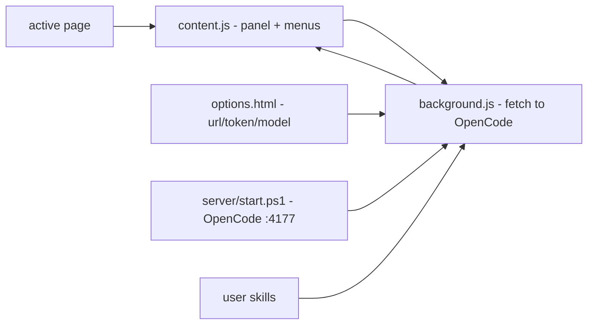

# opencode-browser-chat

**English** · [Português (Brasil)](README.md)

   [](LICENSE)

## What it is

**A floating OpenCode chat in the browser**: a **Chromium (MV3) extension** that overlays a **chat panel** on any page, connected to the **local OpenCode server** (started via PowerShell on port 4177, fixed password). It includes a **pre-prompt menu** when selecting text or images, **keyboard shortcuts** and the **user's skills** as context. Node E2E scripts included. It is the author's personal productivity tool.

## Status

A working extension in the author's daily use (loaded manually via "Load unpacked"). Node/verification scripts included.

## Features

- **Floating panel** (`extension/panel.html` + `panel.js`): chat over the page, with history and send to the OpenCode models.
- **Content script** (`content.js`/`content.css`): injects the panel and the selection menu.
- **Pre-prompt menu**: when selecting **text** or right-clicking an **image** — actions like "Explain the selection" (defined in `manifest.json`).
- **Shortcuts**: open/close the panel.
- **Local server** (`server/start.ps1` / `stop.ps1`): starts OpenCode with a password for the extension (idempotent, no window) — also used by the Windows startup shortcut (`scripts/install-startup.ps1`).
- **Skills**: injects the user's skills as context (`skills-inject-test`).
- **E2E tests** (`scripts/*.mjs`): browser, vision-cascade, model-default, toolcard, parts-render, etc.
- **Generated icons** (`scripts/make-icons.mjs`).

## Architecture

An MV3 extension (`manifest.json`, background, content, options) with no build step — vanilla JS. `background.js` talks to the local server (`http://127.0.0.1:4177`, set in options); the panel is rendered by `content.js` over the active page.



## Stack

- Chromium (Brave/Chrome), Manifest V3, vanilla JS (no build)
- PowerShell 5.1 (server/startup), Node 18+ (test .mjs)

## Repository layout

```
opencode-browser-chat/
├── extension/
│   ├── manifest.json · background.js · content.js/css
│   ├── panel.html/js/css · options.html/js · icons/ · lib/
├── server/            # start.ps1 / stop.ps1 (local OpenCode :4177)
├── scripts/           # .mjs tests + make-icons + install-startup
└── README.md/.en.md
```

## Prerequisites and installation

- Chrome/Brave with **Developer Mode** enabled
- Node 18+ (for the tests) and OpenCode installed

```powershell
.\server\start.ps1
# Load extension/ at chrome://extensions (Load unpacked)
```

## How to run

```bash
node scripts/load-check.mjs
node scripts/browser-test.mjs
```
Day to day: the panel opens via the shortcut and talks to the OpenCode server.

## Tests and quality

Automated tests of the scripts (Node):

```bash
node scripts/load-check.mjs
node scripts/e2e-test.mjs
node scripts/skills-inject-test.mjs
# plus feature-specific scripts in scripts/*.mjs
```
There is no pytest suite — a vanilla-JS extension without structured unit tests.

## Technical decisions and trade-offs

- **No build step** (vanilla JS): direct loading, easy to edit; no typing/framework.
- **Fixed default password in start.ps1** ('testefixo123'): simple for local use; change it for real use.
- **Playwright E2E** in the .mjs scripts: covers critical paths (send, skills, vision features).

## Known limitations and roadmap

- Panel is hosted on the local server: **requires OpenCode running** (`server/start.ps1`).
- Fixed default password — adjust in `start.ps1` beyond local use.

## Development process

An individual project by Kelvin Oliveira, built with orchestrated AI agents and reviewed by the author. In the author's daily use.

## License and author

MIT — Copyright (c) 2026 Kelvin Oliveira.

**Author**: [Kelvin Oliveira](https://github.com/KelvinOliveiraCode) · [Portfolio](https://kelvinoliveiracode.github.io/portfolio/)
