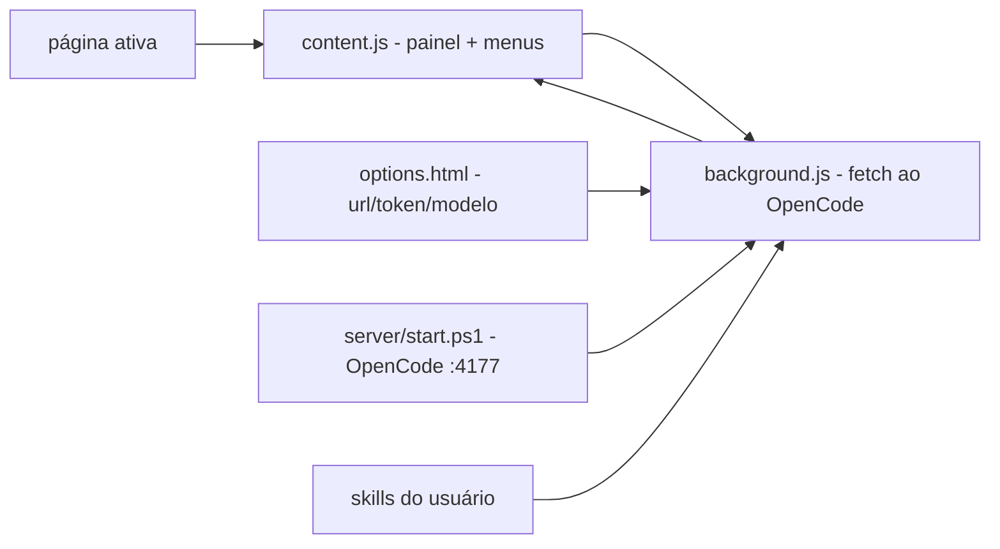

# opencode-browser-chat

[English](README.en.md) · **Português (Brasil)**

   [](LICENSE)

## O que é

**Chat flutuante do OpenCode no navegador**: uma **extensão Chromium (MV3)** que abre um **painel de chat** sobre qualquer página, conectada ao **servidor local do OpenCode** (start em PowerShell na porta 4177, senha fixa). Inclui **menu de pre-prompts** ao selecionar texto ou imagem, **atalhos de teclado** e as **skills do usuário** como base de contexto. Testes E2E dos scripts Node. É uma ferramenta de produtividade pessoal do autor.

## Status

Extensão funcional em uso diário pelo autor (carregada manualmente via "Load unpacked"). Testes Node/scripts de verificação incluídos.

## Funcionalidades

- **Painel flutuante** (`extension/panel.html` + `panel.js`): chat sobre a página, com histórico e envio para os modelos do OpenCode.
- **Content script** (`content.js`/`content.css`): injeta o painel e o menu de seleção.
- **Menu de pre-prompts**: ao selecionar **texto** ou clicar direito em **imagem** — ações como "Explicar a seleção" (definidas no `manifest.json`).
- **Atalhos**: abrir/fechar o painel.
- **Servidor local** (`server/start.ps1` / `stop.ps1`): sobe o OpenCode com senha para a extensão (idempotente, sem janela) — usado também pelo atalho de inicialização do Windows (`scripts/install-startup.ps1`).
- **Skills**: injeta as skills do usuário como contexto (`skills-inject-test`).
- **Testes E2E** (`scripts/*.mjs`): browser, vision-cascade, model-default, toolcard, parts-render etc.
- **Ícones gerados** (`scripts/make-icons.mjs`).

## Arquitetura

Extensão MV3 (`manifest.json`, background, content, options) sem build — JS vanilla. O `background.js` fala com o servidor local (`http://127.0.0.1:4177` nas opções); o painel mostrado pelo `content.js` sobre a página ativa.



## Stack

- Chromium (Brave/Chrome), Manifest V3, JS vanilla (sem build)
- PowerShell 5.1 (servidor/atualização), Node 18+ (testes .mjs)

## Estrutura do repositório

```
opencode-browser-chat/
├── extension/
│   ├── manifest.json · background.js · content.js/css
│   ├── panel.html/js/css · options.html/js · icons/ · lib/
├── server/            # start.ps1 / stop.ps1 (OpenCode local :4177)
├── scripts/           # testes .mjs + make-icons + install-startup
└── README.md/.en.md
```

## Pré-requisitos e instalação

- Chrome/Brave com **Developer Mode** habilitado
- Node 18+ (para os testes) e o OpenCode instalado

```powershell
.\server\start.ps1
# Carregue extension/ em chrome://extensions (Load unpacked)
```

## Como executar

```bash
python -m http.server 8080   # opcional: servir osursos de teste
node scripts/browser-test.mjs
```
No dia a dia: o painel abre pelo atalho e fala com o servidor do OpenCode.

## Testes e qualidade

Testes automatizados dos scripts (Node):

```bash
node scripts/load-check.mjs
node scripts/e2e-test.mjs
node scripts/skills-inject-test.mjs
(or: scripts/*.mjs counterpart scripts for each feature)
```
Não há suíte pytest — extensão JS vanilla sem testes unitários estruturados.

## Decisões técnicas e trade-offs

- **Sem build passo** (JS vanilla): carregamento direto, fácil de editar; sem tipagem/framework.
- **Senhas fixa no start.ps1** (default 'testefixo123'): simples para local; trocar em uso real.
- **E2E com Playwright** nos scripts .mjs: cobre camadas críticas (envio, skills, recursos vision).

## Limitações conhecidas e roadmap

- Painel hospedado no servidor local: **requer o OpenCode rodando** (`server/start.ps1`).
- Password fixo default — para produção, ajuste no `start.ps1`.

## Processo de desenvolvimento

Projeto individual de Kelvin Oliveira, construído com agentes de IA orquestrados e revisado pelo autor. Em uso diário pelo próprio autor.

## Licença e autor

MIT — Copyright (c) 2026 Kelvin Oliveira.

**Autor**: [Kelvin Oliveira](https://github.com/KelvinOliveiraCode) · [Portfólio](https://kelvinoliveiracode.github.io/portfolio/)
